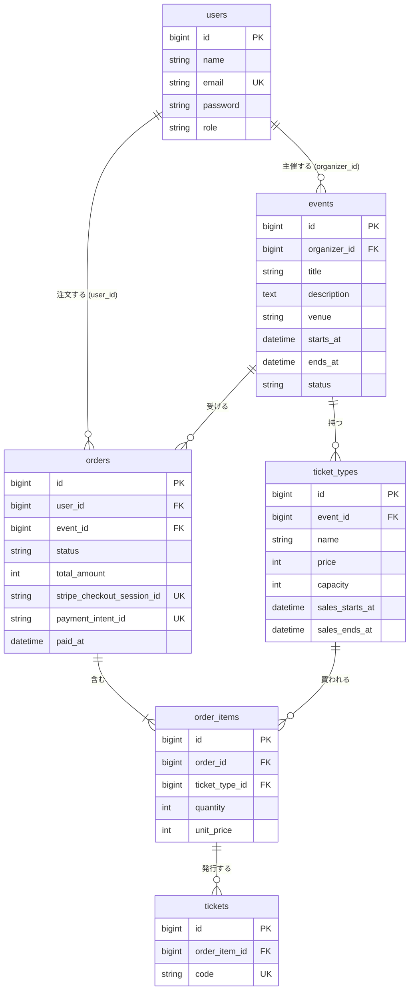

# データベース設計

仕様書（[01_requirements.md](../spec/01_requirements.md)）のコア機能を実現するためのテーブル設計。  
`users` は既存のテーブルに `role` を追加する。新規は `events` / `ticket_types` / `orders` / `order_items` / `tickets` の5つ。

## ER 図



## カラム定義

全テーブルに `id`（bigint, PK）と `created_at` / `updated_at` がある。以下では省略する。

### users（既存に追加）

| カラム | 型 | 制約 | 説明 |
|-|-|-|-|
| role | string | not null, default `customer` | `customer` / `organizer` / `admin`。PHP の Enum にキャストする |

### events

| カラム | 型 | 制約 | 説明 |
|-|-|-|-|
| organizer_id | bigint | not null, FK → users.id | 主催者 |
| title | string | not null | イベント名 |
| description | text | not null | 説明 |
| venue | string | not null | 会場 |
| starts_at | datetime | not null, index | 開催日時。一覧の並び順と「開催済みを除く」に使う |
| ends_at | datetime | not null | 終了日時。`starts_at` より後 |
| status | string | not null, default `draft` | `draft`（下書き） / `published`（公開中） / `unpublished`（管理者が非公開にした状態。主催者は戻せない） |

### ticket_types

| カラム | 型 | 制約 | 説明 |
|-|-|-|-|
| event_id | bigint | not null, FK → events.id | 所属するイベント |
| name | string | not null | 券種名（一般、学生 など） |
| price | unsigned int | not null | 価格（円） |
| capacity | unsigned int | not null | 定員 |
| sales_starts_at | datetime | not null | 販売開始 |
| sales_ends_at | datetime | not null | 販売終了 |

### orders

| カラム | 型 | 制約 | 説明 |
|-|-|-|-|
| user_id | bigint | not null, FK → users.id | 注文者 |
| event_id | bigint | not null, FK → events.id | 対象イベント。1注文は1イベントに限る |
| status | string | not null, default `pending`, index | `pending`（支払い待ち） / `paid`（支払い済み） / `cancelled`（キャンセル） / `refunded`（返金済み）。PHP の Enum（`OrderStatus`）にキャストする |
| total_amount | unsigned int | not null | 合計金額（円）。明細の `unit_price × quantity` の合計 |
| stripe_checkout_session_id | string | nullable, unique | Checkout Session の ID。Stripe へ進むまでは null |
| payment_intent_id | string | nullable, unique | 支払い済みにしたときの PaymentIntent の ID。返金（E3）で注文を特定するために保存する。無料の注文は null |
| paid_at | datetime | nullable | 支払いが確定した日時 |

### order_items

| カラム | 型 | 制約 | 説明 |
|-|-|-|-|
| order_id | bigint | not null, FK → orders.id | 所属する注文 |
| ticket_type_id | bigint | not null, FK → ticket_types.id | 買った券種 |
| quantity | unsigned int | not null | 枚数 |
| unit_price | unsigned int | not null | 注文時点の単価（円）。あとで券種の価格が変わっても注文は変わらない |

`(order_id, ticket_type_id)` に unique を付け、同じ券種は1行にまとめる。

### tickets

| カラム | 型 | 制約 | 説明 |
|-|-|-|-|
| order_item_id | bigint | not null, FK → order_items.id | どの明細から発行されたか。注文と券種はここから辿る |
| code | string | not null, unique | 1枚ごとの固有コード（UUID） |

支払い済みになったとき、明細の `quantity` の枚数分を発行する。

## 外部キーの削除時の動き

お金に関わる記録は restrict、親と一体のものは cascade とする。

| 外部キー | 動き | 理由 |
|-|-|-|
| events.organizer_id → users | restrict | イベントを残したまま主催者が消えるのを防ぐ |
| ticket_types.event_id → events | cascade | 券種はイベントの一部 |
| orders.user_id → users | restrict | 購入の記録を消さない |
| orders.event_id → events | restrict | 注文があるイベントは削除できない |
| order_items.order_id → orders | cascade | 明細は注文の一部 |
| order_items.ticket_type_id → ticket_types | restrict | 売れた券種は削除できない |
| tickets.order_item_id → order_items | cascade | チケットは明細の一部 |

注文が1件でもあるイベントや券種は削除できない。画面側では、DB エラーになる前にポリシーかバリデーションで「注文があるため削除できません」と表示する。

## 残り枚数の計算

残り枚数はカラムに持たず、券種ごとに注文明細から毎回計算する。

```
残り枚数 = capacity − 支払い済みの枚数 − 有効な支払い待ちの枚数
```

| 項目 | 数え方 |
|-|-|
| 支払い済みの枚数 | その券種の `order_items.quantity` のうち、注文が `paid` のものの合計 |
| 有効な支払い待ちの枚数 | その券種の `order_items.quantity` のうち、注文が `pending` かつ `orders.created_at` が15分以内のものの合計 |

- `cancelled` と `refunded` の注文は数えない（枠が戻る）
- 計算結果が 0 未満になる場合は 0 として表示する
- 15分を過ぎた支払い待ちの注文は数えない。放置された注文が枠を占有し続けないようにするため。時間は `OrderService::PENDING_MINUTES` で持つ

### 計算例

定員 50 の券種に、次の注文明細がある場合。

| 注文の状態 | 作成からの時間 | 枚数 | 数えるか |
|-|-|-:|-|
| paid | ─ | 30 | 数える |
| pending | 10分 | 5 | 数える |
| pending | 2時間 | 4 | 数えない |

残り枚数 = 50 − 30 − 5 = 15

### 購入時のチェック（C9）

注文を作る前に、`OrderService::createOrder()` が券種ごとに次の3つを確認する。満たさないときは注文を作らず `PurchaseException` を投げ、画面はそのメッセージを表示する。

- 現在時刻が `sales_starts_at` 以上、`sales_ends_at` 以下である
- 注文する枚数が残り枚数以下である
- 注文する枚数が 1 以上 `OrderService::MAX_QUANTITY`（10）以下である

このほか、イベントが公開中でないとき、券種がそのイベントのものでないときも注文を作らない。

同時に購入された場合の競合（確認と注文作成の間に他の人が買う）はコアでは扱わない。拡張 E2 でトランザクションと行ロックを入れる。

## 未決定の点

- 支払い待ちの保持時間と Stripe の期限: 枠を押さえるのは15分だが、Stripe Checkout Session の有効期限は最短でも30分。15分を過ぎて枠が他の人に渡ったあとに元の注文が支払われると、定員を超える。決済を作るときに扱いを決める
- アカウント削除との衝突: スターターキットのアカウント削除機能は、注文やイベントを持つユーザーだと restrict により DB エラーになる。削除前にチェックして断る処理が必要
- `orders.event_id` は明細から辿れるので冗長だが、主催者の注文一覧と売上（C16）を簡単にするために持つ
- コアの範囲外のため、イベント画像（E14）とチケットの使用日時（E1）は入れていない
